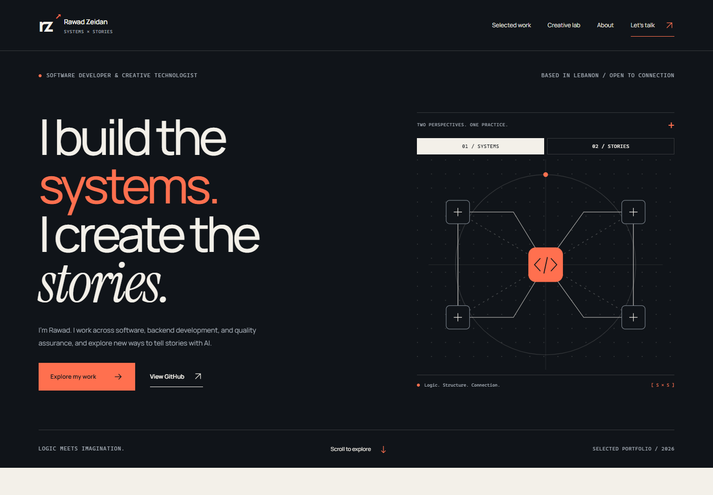

# Rawad Zeidan — Systems × Stories

**Software Developer & Creative Technologist · Lebanon**

A personal portfolio connecting software engineering with original AI-generated filmmaking. The engineering section examines a retail POS application and an exploratory clustering study through their actual implementation and limitations. The Creative Lab presents two original PixVerse AI films.



## Experience

- An interactive Systems / Stories illustration, operated with pointer, touch or keyboard.
- Two detailed case studies: problem, approach, implementation, technical decisions and verification boundaries.
- A cinematic gallery with real film frames, explicit AI attribution and one user-controlled player at a time.
- Professional experience, verified technical capabilities, education and certificates.
- Responsive layouts, visible focus, reduced-motion support and locally served typography.

Source for Rawad Zeidan’s Systems × Stories portfolio. The website has not been deployed. The GitHub profile is [Rawad-01](https://github.com/Rawad-01).

## Run

Use Node.js 24.x. The reviewed environment uses Node 24.14.0 and npm 11.9.0.

```sh
npm ci --ignore-scripts
npm run dev
```

Open the URL printed by Next.js. For the static production build:

```sh
npm run build
npm run preview
```

The preview server binds to `127.0.0.1:3000`, supports MP4 byte ranges and stops with Ctrl+C. It is for local review. `PORT` can select another port.

## Engineering

Next.js 16.4.2, React and strict TypeScript, exported as static HTML. CSS and SVG provide the small set of signature interactions without a motion library. Native links make each prerendered route work on ordinary static hosts without framework-specific prefetch rewrites.

| Area | Location |
| --- | --- |
| Profile, project and career content | `src/data/content.ts` |
| Verified repository destinations | `src/data/repositories.ts` |
| Static routes and metadata | `src/app/` |
| Reusable interaction components | `src/components/` |
| Build-time media availability | `src/lib/film-availability.ts` |
| Design tokens and responsive styles | `src/app/globals.css` |
| Images, identity and font licenses | `public/` |
| Local preview and browser checks | `scripts/` |

The homepage deliberately gives the two selected projects different editorial layouts. Adding another project requires placing its feature deliberately on the homepage; new case-study routes are generated from the data. Skills are not expressed as invented proficiency percentages, and no project claims sole authorship or unverified adoption.

## Featured source repositories

- [Mini Market POS](https://github.com/Rawad-01/mini-market-pos): retail workflows, relational data and copied-code validation.
- [Student Performance Clustering](https://github.com/Rawad-01/student-performance-clustering): reproducible exploratory analysis with explicit methodological limits.

## Films and a fresh checkout

Large viewing files are excluded from Git. A source-only checkout still builds and displays the genuine posters and credits, with a working **Request viewing link** email action. It does not render a play button for a missing local file.

To enable local viewing, place the approved files at `public/media/boukra.mp4` and `public/media/oman.mp4`, then rebuild. Alternatively, configure `BOUKRA_VIDEO_URL` and `OMAN_VIDEO_URL` with approved HTTPS MP4/WebM viewing URLs. Direct file delivery must support byte ranges and the correct MIME type. A watch-page URL is not a media source.

See [media setup](docs/media.md) for captions, transcripts, dimensions and delivery details. The working titles are proposals, clearly labeled. Rawad confirmed independent original concept, PixVerse AI generation and editing for both films. Captions/transcripts and final titles remain release-review items.

## Validation

```sh
npm run build
npm run typecheck
npm run preview
```

In a second terminal, run `npm run test:browser`. The script uses installed Chrome/Edge on Windows, or a Chromium path supplied through `BROWSER_PATH`; it does not download a browser. `QA_URL` selects another preview URL. With viewing copies configured, set `QA_MEDIA=1` to include video playback checks. Without it, the suite checks the source-only gallery fallback.

The checks cover three routes, real image decoding, responsive overflow, keyboard state, reduced-motion transitions, media requests, local navigation, console errors and axe accessibility rules. The media mode also checks decoding, playback, Escape and restored focus. See [verification scope](docs/verification.md) for actual results and what has not been tested. Automated checks do not establish full accessibility compliance or real-world performance.

## Deploy on Vercel

See [Vercel deployment](docs/vercel.md) for project settings, production metadata and film delivery. The repository supplies `vercel.json` and pins Node 24.x. Deployment uses your own Vercel account.

## Content and publication configuration

- The only confirmed profile URL is `https://github.com/Rawad-01`.
- Engineering source links use the verified public repository URLs in `src/data/repositories.ts`. Future projects should keep `status: "proposed"` until their repositories are created and checked.
- Vercel production metadata uses its assigned production domain automatically. `NEXT_PUBLIC_SITE_URL` can override it with a confirmed custom HTTPS origin. Preview/development deployments remain noindex. Local builds without an origin remain noindex with an empty sitemap.
- Contact is a `mailto:` link. No email-delivery backend, analytics, database or account service is required.
- Build again after changing media or domain configuration. Static output captures configuration at build time.
- `out/` is the deployable artifact. Review hosting configuration separately; this source contains no automatic deployment workflow.

## Attribution

See [asset credits](ASSET_CREDITS.md). Real notebook figures are distinguished from abstract architecture illustrations. User-supplied career and education details are the source of truth for professional claims. Rawad confirmed permission to share the selected code and figures. Exact academic contribution details remain unverified; no sole-authorship claim is made.

No code license has been selected on the owner's behalf. Third-party fonts and dataset materials retain their own terms. Do not infer permission to reuse film, coursework or client material from this repository's presence.
